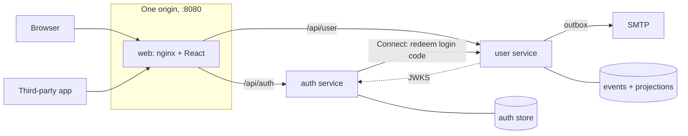

# 🧰 go-api-boilerplate

[](https://github.com/vardius/go-api-boilerplate/actions/workflows/ci.yml)
[](https://goreportcard.com/report/github.com/vardius/go-api-boilerplate)
[](LICENSE.md)

A starting point for a Go API that has to be right from day one: two
services, real sign-in, OAuth 2 for third-party apps, and the tests and
tooling to keep it that way.

- **Event-sourced user service.** DDD aggregate, versioned events with
  upcasters, projections in the same transaction, and a transactional
  outbox for email.
- **OAuth 2 auth service.** Email and Google sign-in, rotating refresh
  tokens with reuse detection, authorization code with PKCE, client
  credentials, ES256 access tokens (RFC 9068) verified through JWKS.
- **Three stores, one contract.** Memory, MySQL or MongoDB, picked at build
  time; every backend passes the same contract suites.
- **Standard library first.** Plain `net/http` handlers on
  [gorouter](https://github.com/vardius/gorouter), `log/slog`, OpenTelemetry,
  Connect between the services, RFC 9457 errors.
- **Ready for AI-assisted work.** `AGENTS.md` in every area, code
  standards, recipes for common changes, and import rules enforced by a
  test.

📖 **[Documentation](https://vardius.github.io/go-api-boilerplate/)**

## Quick start

You need Docker.

```bash
git clone https://github.com/vardius/go-api-boilerplate.git
cd go-api-boilerplate
docker compose up --wait
```

Open http://localhost:8080 and sign in with any email address; the link
arrives in Mailpit at http://localhost:8025. The quick start keeps data in
memory, so a restart clears it. For a database:

```bash
make up STORE=mysql
```

`make help` lists the rest. `make check` runs what CI runs.

## Architecture



The browser holds only HttpOnly cookies, set by the auth service. Both
services verify access tokens locally against the auth service's JWKS.

## Layout

| Path | What lives there |
| --- | --- |
| [`cmd/`](cmd) | one binary per service |
| [`internal/platform/`](internal/platform) | the shared kit: config, observability, HTTP, tokens, event sourcing, outbox, databases |
| [`internal/user/`](internal/user), [`internal/auth/`](internal/auth) | the services |
| [`proto/`](proto), [`gen/`](gen), [`api/`](api) | the Connect contract and the OpenAPI documents |
| [`web/`](web) | the React app |
| [`e2e/`](e2e) | end-to-end tests against the running stack |
| [`deploy/`](deploy) | compose extras and the Helm chart |
| [`website/`](website) | the documentation site |

Upgrading from the 2022 layout? It is tagged
[`legacy-2022`](https://github.com/vardius/go-api-boilerplate/tree/legacy-2022).

## Contributing

Read [CONTRIBUTING.md](.github/CONTRIBUTING.md) and [AGENTS.md](AGENTS.md).
Report security problems privately, as [SECURITY.md](.github/SECURITY.md)
describes.

## 💲 Sponsoring

<p align="center">
  <a href="https://opencollective.com/go-api-boilerplate/contribute/sponsor-10349/checkout"></a>
  <a href="https://opencollective.com/go-api-boilerplate/contribute/sponsor-10350/checkout"></a>
</p>

## 👨🏻‍💻👩🏾‍💻 Core Team

<table>
  <tbody>
    <tr>
      <td align="center" valign="top">
        
        <br>
        <a href="http://rafallorenz.com">Rafał Lorenz</a>
      </td>
      <td align="center" valign="top">
        
        <br>
        <a href="https://github.com/mar1n3r0">Marin Kirkov</a>
      </td>
   </tr>
  </tbody>
</table>

## 👥 Backers

Support us with a monthly donation and help us continue our activities.

<a href="https://opencollective.com/go-api-boilerplate/backer/0/website" target="_blank"></a>
<a href="https://opencollective.com/go-api-boilerplate/backer/1/website" target="_blank"></a>
<a href="https://opencollective.com/go-api-boilerplate/backer/2/website" target="_blank"></a>
<a href="https://opencollective.com/go-api-boilerplate/backer/3/website" target="_blank"></a>
<a href="https://opencollective.com/go-api-boilerplate/backer/4/website" target="_blank"></a>
<a href="https://opencollective.com/go-api-boilerplate/backer/5/website" target="_blank"></a>
<a href="https://opencollective.com/go-api-boilerplate/backer/6/website" target="_blank"></a>
<a href="https://opencollective.com/go-api-boilerplate/backer/7/website" target="_blank"></a>
<a href="https://opencollective.com/go-api-boilerplate/backer/8/website" target="_blank"></a>
<a href="https://opencollective.com/go-api-boilerplate/backer/9/website" target="_blank"></a>
<a href="https://opencollective.com/go-api-boilerplate/backer/10/website" target="_blank"></a>
<a href="https://opencollective.com/go-api-boilerplate/backer/11/website" target="_blank"></a>
<a href="https://opencollective.com/go-api-boilerplate/backer/12/website" target="_blank"></a>
<a href="https://opencollective.com/go-api-boilerplate/backer/13/website" target="_blank"></a>
<a href="https://opencollective.com/go-api-boilerplate/backer/14/website" target="_blank"></a>
<a href="https://opencollective.com/go-api-boilerplate/backer/15/website" target="_blank"></a>
<a href="https://opencollective.com/go-api-boilerplate/backer/16/website" target="_blank"></a>
<a href="https://opencollective.com/go-api-boilerplate/backer/17/website" target="_blank"></a>
<a href="https://opencollective.com/go-api-boilerplate/backer/18/website" target="_blank"></a>
<a href="https://opencollective.com/go-api-boilerplate/backer/19/website" target="_blank"></a>
<a href="https://opencollective.com/go-api-boilerplate/backer/20/website" target="_blank"></a>
<a href="https://opencollective.com/go-api-boilerplate/backer/21/website" target="_blank"></a>
<a href="https://opencollective.com/go-api-boilerplate/backer/22/website" target="_blank"></a>
<a href="https://opencollective.com/go-api-boilerplate/backer/23/website" target="_blank"></a>
<a href="https://opencollective.com/go-api-boilerplate/backer/24/website" target="_blank"></a>
<a href="https://opencollective.com/go-api-boilerplate/backer/25/website" target="_blank"></a>
<a href="https://opencollective.com/go-api-boilerplate/backer/26/website" target="_blank"></a>
<a href="https://opencollective.com/go-api-boilerplate/backer/27/website" target="_blank"></a>
<a href="https://opencollective.com/go-api-boilerplate/backer/28/website" target="_blank"></a>
<a href="https://opencollective.com/go-api-boilerplate/backer/29/website" target="_blank"></a>

## 🥇 Sponsors

Proudly sponsored by [Open Collective sponsors](https://opencollective.com/go-api-boilerplate#sponsor).

- 👥 [Contribute on Open Collective](https://opencollective.com/go-api-boilerplate#sponsor)

## 📜 [License](LICENSE.md)
